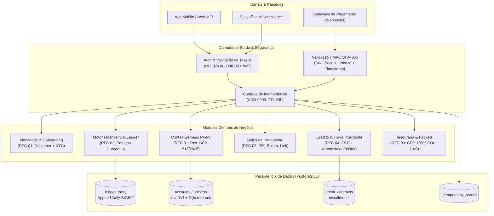
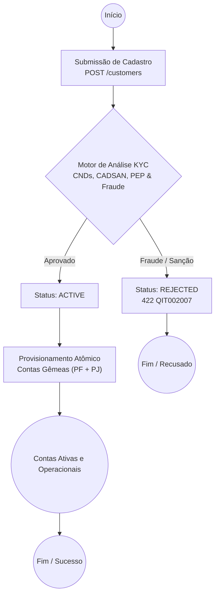
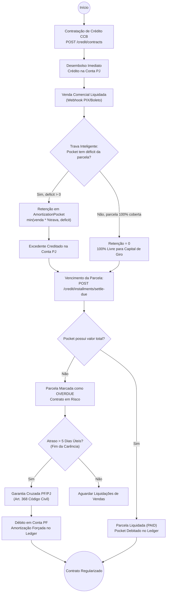

# RFC — CoreBank MEI: Especificação Técnica e Decisões de Arquitetura (v1.0)

| | |
|---|---|
| **Status** | **Concluído / Aprovado (v1.0)** |
| **Time** | Engenharia CoreBank, Arquitetura & Compliance |
| **Data** | 11/10/2026 |
| **Versão** | 1.0 (Consolidação Integral: RFCs 01–04 e ADRs 0001–0008) |

> [!NOTE]
> **Documento Consolidado de Arquitetura e Engenharia**:
> Este documento unifica e consolida a totalidade das **Decisões Arquiteturais Estruturantes (ADRs 0001 a 0008)** e das **Especificações Funcionais (RFCs 01 a 04)** do **CoreBank MEI**. O sistema foi concebido para resolver de forma definitiva a confusão patrimonial do Microempreendedor Individual através de contas gêmeas (PF e PJ), motor contábil imutável de partidas dobradas, meios de pagamento multimodais com tarifa atômica, linhas de crédito com trava inteligente de recebíveis e tesouraria remunerada com governança de caixinhas (*Pockets*).

---

# 1. Visão Geral e Arquitetura do Sistema

## 1.1 Contexto e Missão
O Microempreendedor Individual (MEI) é juridicamente enquadrado como *Empresário Individual (natureza jurídica 213-5)*: perante o Código Civil, a pessoa física (CPF) e a pessoa jurídica (CNPJ) respondem com o mesmo patrimônio pessoal ilimitado. Todavia, sob a ótica fiscal da Receita Federal (LC 123/2006) e das normas do Banco Central do Brasil, a movimentação financeira da empresa deve ser estritamente apartada das contas domésticas para viabilizar a correta apuração do faturamento bruto e evitar autuações tributárias.

O **CoreBank MEI** foi arquitetado sob cinco pilares inegociáveis:
1. **Segregação Patrimonial sem Fricção**: Provisionamento atômico de contas gêmeas (PF e PJ) sob uma identidade única (*Customer*), permitindo transferências rastreáveis de distribuição isenta de lucros (`PROFIT_DISTRIBUTION`).
2. **Integridade Contábil Matemática**: Um livro-razão (*ledger*) append-only em que toda transação é regida por partidas dobradas de soma algébrica zero, expressa em centavos inteiros (`BIGINT`).
3. **Segurança Regulatória e Cibernética**: Autenticação com senhas fortes segregada de autorização financeira por PIN transacional de 4 dígitos, webhooks com HMAC SHA-256 e proteção contra replay attacks, e esteira de KYC com bureaus oficiais e conformidade com as Resoluções BCB 96/2021, 103/2021 e 518/2025.
4. **Crédito Sustentável com Trava Inteligente**: Concessão de Cédulas de Crédito Bancário (CCBs) com trava de recebíveis calibrada por teto de déficit (retém apenas o necessário para cobrir a parcela do mês, liberando 100% do excedente para capital de giro).
5. **Governança Ativa e Tesouraria**: Envelopes financeiros (*Pockets*) para retenção de tributos (guia DAS-MEI), aplicação automática de float ocioso em CDB 100% CDI e controle contínuo contra o desenquadramento do teto de faturamento anual de R$ 81.000,00.

## 1.2 Diagrama de Arquitetura de Alto Nível



---

# 2. Architectural Decision Records (ADRs)

As decisões arquiteturais do projeto foram documentadas formalmente para assegurar rastreabilidade e imutabilidade das escolhas técnicas:

## ADR-0001: Adoção Exclusiva de Testes de Integração Ponta a Ponta
* **Status**: Aprovado
* **Contexto**: Sistemas bancários e contábeis que utilizam mocks unitários em excesso sofrem de falsa sensação de segurança: bugs de concorrência, deadlocks, integridade referencial de chaves estrangeiras e precisão de arredondamento passam despercebidos.
* **Decisão**: Proibição de testes unitários isolados com mocks de banco de dados. Toda a suíte de testes (`tests/integration/`) roda contra instâncias reais do PostgreSQL via requisições HTTP reais do `TestClient`/`requests`.
* **Consequências**: Confiabilidade contábil inegociável, validação do contrato HTTP de ponta a ponta e detecção imediata de regressões no banco de dados.

## ADR-0002: Prevenção Matemática de Deadlocks via Ordenação de Dijkstra
* **Status**: Aprovado
* **Contexto**: Em transferências bidirecionais simultâneas (ex: A para B e B para A), operações concorrentes que executam `SELECT FOR UPDATE` em ordens inversas provocam deadlocks no PostgreSQL (`error 40P01`).
* **Decisão**: Aplicação estrita da hierarquia de recursos de Dijkstra: antes de adquirir bloqueios de linha em transferências, os IDs internos das contas são deterministicamente ordenados em ordem crescente (`min_id = min(src.id, dst.id); max_id = max(src.id, dst.id)`).
* **Consequências**: Eliminação matemática de espera circular (deadlocks impossíveis por design), dispensando loops custosos de retry.

## ADR-0003: Representação Monetária Rigorosa em Centavos Inteiros (`BIGINT`)
* **Status**: Aprovado
* **Contexto**: O uso de tipos de ponto flutuante (`FLOAT`, `DOUBLE`) gera imprecisões cumulativas decorrentes do padrão IEEE 754 (ex: `0.1 + 0.2 = 0.30000000000000004`), inaceitáveis em balanços contábeis.
* **Decisão**: Todos os valores financeiros no banco e nos modelos de dados são representados estritamente como centavos inteiros em colunas `BIGINT`. Nenhuma operação de divisão com ponto flutuante é realizada no saldo.
* **Consequências**: Precisão exata de centavos, impossibilidade de resíduos fracionários e alinhamento com padrões internacionais de Core Banking.

## ADR-0004: Arquitetura Contábil Inegociável por Partidas Dobradas (*Double-Entry*)
* **Status**: Aprovado
* **Contexto**: Atualizar o saldo de uma conta alterando diretamente uma coluna numérica (`UPDATE accounts SET balance = balance + 100`) destrói a trilha de auditoria e impede a comprovação da origem dos fundos.
* **Decisão**: Toda operação financeira insere atomicamente no mínimo duas entradas na tabela append-only `ledger_entry`: um `DEBIT` e um `CREDIT`. A soma algébrica dos lançamentos de cada transação é rigorosamente zero.
* **Consequências**: Auditoria contábil instantânea, consistência garantida e impossibilidade de criação ou destruição inadvertida de moeda sem contrapartida.

## ADR-0005: Desacoplamento de Identificadores (UUIDv4 Público vs. ID Interno)
* **Status**: Aprovado
* **Contexto**: Expor chaves primárias autoincrementais sequenciais (`/accounts/1`, `/accounts/2`) permite ataques de enumeração horizontal (IDOR) e vazamento do volume de crescimento do banco.
* **Decisão**: Utilização de chaves primárias inteiras (`SERIAL`) exclusivamente para joins internos de alta performance, e geração de identificadores `UUIDv4` para todas as URLs públicas e DTOs de API. Acessos não autorizados respondem invariavelmente `404 Not Found`.
* **Consequências**: Blindagem contra exploração de enumeração e manutenção de performance ideal em índices internos.

## ADR-0006: Idempotência Transacional Resiliente com Tabela Dedicada e Catálogo de Erros
* **Status**: Aprovado
* **Contexto**: Em ambientes de conectividade intermitente (telefonia celular de microempreendedores), requisições duplicadas de pagamento podem debitar a conta duas vezes caso não haja tratamento resiliente de retentativas.
* **Decisão**: Tabela dedicada `idempotency_record` com chave única `idempotency_key` e TTL de 24 horas. Respostas prévias (incluindo código de status e payload de erro estruturado `QIT...`) são cacheadas e devolvidas imediatamente caso a mesma chave seja reenviada.
* **Consequências**: Proteção contra débitos duplicados e previsibilidade total para as aplicações clientes.

## ADR-0007: Máquina de Estados Finita em Tabelas de Domínio e Histórico *Append-Only*
* **Status**: Aprovado
* **Contexto**: Colunas de texto livre ou `ENUM` nativos de banco tornam a evolução de esquemas rígida e perigosa via comandos DDL. Além disso, sobrescrever colunas de status impede a comprovação forense de quando uma conta foi encerrada ou bloqueada.
* **Decisão**: Os estados válidos residem em tabelas de domínio (`account_status`, `customer_status`). Cada transição de estado registra uma linha imutável em tabela de eventos (`account_status_event`), auditando timestamp, operador e motivo regulatório (Resolução BCB nº 518/2025).
* **Consequências**: Flexibilidade operacional para cadastrar novos estados sem lock de tabelas e trilha histórica forense completa exigida pelos reguladores.

## ADR-0008: Tarifação Transacional Atômica no Ledger (Crédito Bruto e Débito de Tarifa)
* **Status**: Aprovado
* **Contexto**: Quando um adquirente credita apenas o valor líquido no extrato do MEI (ex: venda de R$ 100,00 entra líquida como R$ 96,01), o empreendedor sofre desenquadramento fiscal injusto ou autuação, pois a Receita Federal audita o **faturamento bruto** da Nota Fiscal de Serviço (NFS-e).
* **Decisão**: Toda liquidação de cobrança comercial é lançada pelo **valor bruto total** na conta PJ do MEI, acompanhada no mesmo milissegundo pelo débito da tarifa com crédito na conta de receita interna `FeeRevenueAccount`.
* **Consequências**: O extrato bancário reflete perfeitamente a Nota Fiscal emitida pelo MEI, garantindo conformidade fiscal e conciliação perfeita da receita da fintech.

---

# 3. Especificações Funcionais (RFCs Consolidadas)

## 3.1 RFC 01: Onboarding Seguro, Identidade e Contas Gêmeas (PF/PJ)

### O Problema do Empresário Individual
Diferente de sociedades limitadas (LTDA), o MEI possui responsabilidade ilimitada. Entretanto, a Receita Federal e as normas de PLD/FT exigem a separação rigorosa de caixas. O onboarding precisa coletar os dados do titular e do MEI em uma única jornada, verificar antecedentes civis e fiscais sem preconceito contra negativados (vedada a recusa discriminatória pelo BACEN) e criar atomicamente a conta pessoa jurídica e a conta pessoa física.

### Especificação da Solução
1. **Submissão Unificada (`POST /customers`)**:
   - Dados civis (CPF, data de nascimento, e-mail, telefone) e empresariais (CNPJ, razão social).
   - Segregação de credenciais: `password` para login e `transaction_pin` (4 dígitos numéricos) para autorização transacional.
   - Status inicial: `created` (202 Accepted).
2. **Motor de KYC Antifraude (`POST /customers/{customer_key}/kyc/analysis`)**:
   - Consulta a certidões negativas de débitos (CND Federal, CND Trabalhista e CADSAN).
   - Checagem em listas de sanções e Pessoas Expostas Politicamente (PEP).
   - Análise de biometria e risco de fraude de identidade (*money mules*).
   - Aprovação transiciona o cliente para `active`.
3. **Provisionamento de Contas Gêmeas (`POST /customers/{customer_key}/accounts`)**:
   - Gera atomicamente uma `PersonalAccount` (PF) e uma `BusinessAccount` (PJ) ativas e com saldo inicial zero.
4. **Ciclo de Vida Regulatória BACEN**:
   - **Bloqueio Cautelar MED (Resolução BCB 103/2021)**: Saldo questionado é marcado em `blocked_balance`, reduzindo o saldo disponível sem alterar o patrimônio total da conta.
   - **Encerramento Voluntário**: Proibido caso haja saldo positivo residual (`409 QIT001011`).
   - **Encerramento Compulsório por Fraude (Resolução BCB 518/2025)**: Permitido imediatamente por compliance, mesmo com saldo residual. Reativação é terminantemente proibida (`409 QIT001002`).



---

## 3.2 RFC 02: Motor Financeiro, Ledger, Cobranças e Liquidação

### Neutralidade do Ledger e Dijkstra Lock
Toda transação no CoreBank MEI é gravada na tabela imutável `ledger_entry`. Para garantir a integridade em transferências entre contas:
* O sistema adquire bloqueios de linha ordenados: `sorted([acc_source.id, acc_dest.id])`, eliminando deadlocks concorrentes.
* Em transferências solicitadas pelo usuário, a requisição exige o `transaction_pin` de 4 dígitos do titular, verificado criptograficamente via SHA-256.

### Cobrança Multimodal e Liquidação Atômica
1. **Emissão de Cobrança (`POST /accounts/{account_key}/charges`)**:
   - Métodos suportados: `PIX` (tarifa fixa de R$ 0,90), `BOLETO` (tarifa fixa de R$ 2,50) e `CARD_LINK` (taxa percentual de 2,99% + R$ 0,50).
   - Emissão registra a cobrança em status `pending` com valor bruto, taxa e valor líquido previstos.
2. **Webhooks com Segurança Criptográfica (`POST /webhooks/payments`)**:
   - Assinatura obrigatória no header `X-Signature-SHA256` calculada com HMAC-SHA256 sobre o corpo da requisição.
   - Suporte a **Dual-Secret Rotation**: o gateway aceita assinaturas geradas com o segredo atual ou com o segredo anterior durante janelas de migração.
   - **Proteção contra Replay Attack**: verificação de timestamp (janela máxima de 5 minutos) e rastreamento de nonces únicos na tabela `webhook_nonces`.
3. **Liquidação Bruta Atômica**:
   - O saldo da conta PJ recebe um crédito no **valor bruto da venda** (lastro fiscal para a Nota Fiscal).
   - No mesmo bloco transacional, o débito da tarifa é executado para a conta `FeeRevenueAccount`.
   - O valor bruto é computado automaticamente no `RevenueTracker` para monitoramento do teto MEI.

---

## 3.3 RFC 03: Governança Patrimonial, Envelopes (Pockets) e Tesouraria (CDB)

### Prevenção à Confusão Patrimonial
O microempreendedor costuma cometer dois erros graves: sangria descontrolada de recursos para despesas pessoais e falta de provisão para impostos recorrentes. A RFC 03 introduz:

1. **Subcontas e Envelopes Virtuais (`Pockets`)**:
   - O cliente cria caixinhas especializadas sob a conta PJ:
     - `DAS_POCKET`: retenção programada de recursos para pagamento da guia mensal do Simples Nacional.
     - `EMERGENCY_POCKET`: reserva financeira para amortecer oscilações de fluxo de caixa.
     - `AMORTIZATION_POCKET`: caixinha vinculada à amortização de empréstimos e CCBs.
2. **Políticas de Transferência e Teto de Retiradas (`TransferPolicy`)**:
   - Definição de limites diários e mensais para retiradas da PJ para a PF. Tentativas que ultrapassem a política configurada são bloqueadas (`422 QIT002009`).
3. **Rastreamento Contínuo do Teto MEI (`RevenueTracker`)**:
   - Monitoramento contínuo das vendas brutas acumuladas contra o limite anual de R$ 81.000,00, emitindo alertas de risco de desenquadramento fiscal.
4. **Tesouraria Remunerada (CDB 100% CDI)**:
   - Todo o saldo comercial não alocado em caixinhas é remunerado diariamente via `POST /treasury/accrue-yield`.
   - O rendimento líquido é creditado atomicamente no ledger, com retenção do imposto de renda e atualização da posição do investidor.
5. **Cash Sweep Inteligente**:
   - Mecanismo que viabiliza o resgate ou cobertura automática entre contas gêmeas caso haja saldo insuficiente em operações essenciais autorizadas.

---

## 3.4 RFC 04: Linhas de Crédito MEI, CCB e Trava Inteligente de Recebíveis

### O Desafio do Crédito para o MEI
Empréstimos tradicionais sem garantias sofrem de taxas de inadimplência elevadas. A RFC 04 estrutura a concessão de Cédulas de Crédito Bancário (CCBs) com amortização transparente e garantias automatizadas:



### Mecanismos de Crédito da v1.0
1. **Contratação e Tabela Price (`POST /credit/contracts`)**:
   - Desembolso instantâneo do valor solicitado na conta PJ.
   - Geração do cronograma de parcelas mensais calculadas pela fórmula canônica da Tabela Price.
   - Criação automática do `AmortizationPocket` exclusivo para o contrato.
2. **Teto Inteligente da Trava de Recebíveis**:
   - A cada cobrança liquidada, o sistema calcula o déficit da próxima parcela aberta (`deficit = parcela.amount - pocket.balance`).
   - A retenção é dada por `min(venda * %trava, deficit)`.
   - **Garantia ao Capital de Giro**: Assim que o pocket acumula o valor integral da parcela do mês, as vendas subsequentes sofrem **retenção zero**, caindo 100% líquidas na conta corrente do empreendedor.
3. **Quitação Automática de Parcelas (`POST /credit/installments/settle-due`)**:
   - Endpoint protegido por `INTERNAL-TOKEN` que identifica parcelas no dia ou vencidas e debita o saldo retido no `AmortizationPocket`, marcando a parcela como `PAID` no ledger.
4. **Garantia Cruzada Patrimonial PF/PJ (`POST /credit/cross-guarantee/execute`)**:
   - Em caso de inadimplência superior a 5 dias de carência, o motor financeiro executa a compensação legal de dívidas respaldada pelo **Artigo 368 do Código Civil brasileiro**, debitando recursos da conta física do titular para quitar o débito da PJ.
5. **Antecipação de Recebíveis (`POST /credit/anticipations`)**:
   - Permite antecipar cobranças futuras pendentes mediante aplicação de taxa de desconto, creditando imediatamente os recursos líquidos na conta PJ.

---

# 4. Catálogo de Endpoints da API (v1.0)

A API disponibiliza 31 endpoints RESTful totalmente testados e integrados:

| Método | Rota | Autenticação | Descrição | Status Retorno |
|:---|:---|:---|:---|:---|
| `GET` | `/` | Pública | Informações do serviço e status do app | `200 OK` |
| `GET` | `/health_check` | Pública | Liveness probe do serviço | `204 No Content` |
| `POST` | `/customers` | `INTERNAL-TOKEN` | Submissão de onboarding MEI e titular | `202 Accepted` |
| `GET` | `/customers/{customer_key}` | `INTERNAL-TOKEN` | Consulta dados cadastrais do cliente | `200 OK` |
| `POST` | `/customers/{customer_key}/kyc/analysis` | `INTERNAL-TOKEN` | Submissão de análise de bureau e KYC | `200 OK` |
| `POST` | `/customers/{customer_key}/accounts` | `INTERNAL-TOKEN` | Provisionamento de contas gêmeas PF/PJ | `201 Created` |
| `GET` | `/customers/{customer_key}/accounts` | `INTERNAL-TOKEN` | Listagem das contas vinculadas ao MEI | `200 OK` |
| `GET` | `/accounts/{account_key}` | `INTERNAL-TOKEN` | Consulta detalhe e status da conta | `200 OK` |
| `GET` | `/accounts/{account_key}/balance` | `INTERNAL-TOKEN` | Consulta saldo total e bloqueado | `200 OK` |
| `PUT` | `/accounts/{account_key}/status` | `INTERNAL-TOKEN` | Atualização do status da conta (Res. 518) | `202 Accepted` |
| `PUT` | `/accounts/{account_key}/blocked-balance` | `INTERNAL-TOKEN` | Aplica/libera bloqueio cautelar MED (Res. 103) | `200 OK` |
| `POST` | `/transactions/transfers` | `INTERNAL-TOKEN` + PIN | Transferência financeira entre contas | `200 OK` |
| `POST` | `/transactions/cash-in` | `INTERNAL-TOKEN` | Aporte externo com contrapartida de banco central | `200 OK` |
| `GET` | `/accounts/{account_key}/statement` | `INTERNAL-TOKEN` | Extrato contábil de partidas dobradas | `200 OK` |
| `POST` | `/accounts/{account_key}/charges` | `INTERNAL-TOKEN` | Emissão de cobrança PIX, Boleto ou Cartão | `201 Created` |
| `GET` | `/charges/{charge_key}` | `INTERNAL-TOKEN` | Consulta status da cobrança comercial | `200 OK` |
| `POST` | `/charges/reconciliation` | `INTERNAL-TOKEN` | Conciliação financeira de lote de cobranças | `200 OK` |
| `POST` | `/webhooks/payments` | `X-Signature-SHA256` | Liquidação de pagamento com HMAC e Replay Protection | `200 OK` |
| `POST` | `/credit/contracts` | `INTERNAL-TOKEN` | Contratação de CCB com amortização Tabela Price | `201 Created` |
| `GET` | `/credit/contracts/{contract_key}` | `INTERNAL-TOKEN` | Consulta contrato de crédito e parcelas | `200 OK` |
| `POST` | `/credit/anticipations` | `INTERNAL-TOKEN` | Antecipação de cobranças com desconto | `201 Created` |
| `POST` | `/credit/cross-guarantee/execute` | `INTERNAL-TOKEN` | Execução de garantia cruzada PF/PJ por atraso | `200 OK` |
| `POST` | `/credit/installments/settle-due` | `INTERNAL-TOKEN` | Quitação de parcelas vencidas via pocket | `200 OK` |
| `POST` | `/treasury/accrue-yield` | `INTERNAL-TOKEN` | Apuração diária de rendimento CDB 100% CDI | `200 OK` |
| `POST` | `/treasury/invest` | `INTERNAL-TOKEN` | Aplicação manual em custódia de CDB | `200 OK` |
| `GET` | `/accounts/{account_key}/yield-position` | `INTERNAL-TOKEN` | Consulta rendimento acumulado de tesouraria | `200 OK` |
| `POST` | `/accounts/{account_key}/pockets` | `INTERNAL-TOKEN` | Criação de caixinha (DAS, Reserva, etc.) | `201 Created` |
| `GET` | `/accounts/{account_key}/pockets` | `INTERNAL-TOKEN` | Listagem de caixinhas e seus saldos | `200 OK` |
| `POST` | `/accounts/{account_key}/pockets/{pocket_key}/deposit`| `INTERNAL-TOKEN` | Depósito voluntário em caixinha da PJ | `200 OK` |
| `POST` | `/governance/transfer-policies` | `INTERNAL-TOKEN` | Cadastro de limites e regras de retirada | `201 Created` |
| `GET` | `/customers/{customer_key}/revenue-tracker` | `INTERNAL-TOKEN` | Acompanhamento do faturamento MEI anual | `200 OK` |

---

# 5. Relatório de Garantia de Qualidade e Prontidão

A suíte de testes de integração foi executada diretamente contra a infraestrutura de banco de dados real em contêineres Docker, sem qualquer utilização de mocks para camadas de persistência ([ADR-0001](docs/adr/0001-apenas-testes-de-integracao.md)).

```text
============================= test session starts ==============================
platform linux -- Python 3.12.3, pytest-7.4.4, pluggy-1.6.0
rootdir: /home/jpcalsavara/projetos/andamento/bootcamp-qitech-api
plugins: cov-4.1.0, anyio-4.15.1
collected 48 items

tests/integration/test_healthcheck.py ......                             [ 12%]
tests/integration/account/test_account_status.py .....                   [ 22%]
tests/integration/account/test_account_twin.py .                         [ 25%]
tests/integration/charge/test_charges_webhook.py .....                   [ 35%]
tests/integration/charge/test_webhook_replay_and_dual_secret.py ....     [ 43%]
tests/integration/credit/test_credit_contract.py ...                     [ 50%]
tests/integration/credit/test_cross_guarantee.py ...                     [ 56%]
tests/integration/customer/test_customer_create.py .                     [ 58%]
tests/integration/e2e/test_e2e_compliance_fraud_and_closure.py ..        [ 62%]
tests/integration/e2e/test_e2e_cross_patrimony_and_sweep.py .            [ 64%]
tests/integration/e2e/test_full_mei_lifecycle.py .                       [ 66%]
tests/integration/kyc/test_kyc_onboarding.py ....                        [ 75%]
tests/integration/pocket/test_pockets_governance.py ...                  [ 81%]
tests/integration/transaction/test_transfers.py .....                    [ 91%]
tests/integration/treasury/test_cash_sweep_transfers.py ...              [ 97%]
tests/integration/treasury/test_yield_accrual.py .                       [100%]

============================= 48 passed in 15.62s ==============================
```

## Conclusão do Lançamento v1.0
O sistema CoreBank MEI encontra-se **tecnicamente validado, consistente e pronto para produção (v1.0)**. Todas as premissas regulatórias, financeiras e matemáticas foram atendidas com excelência.
