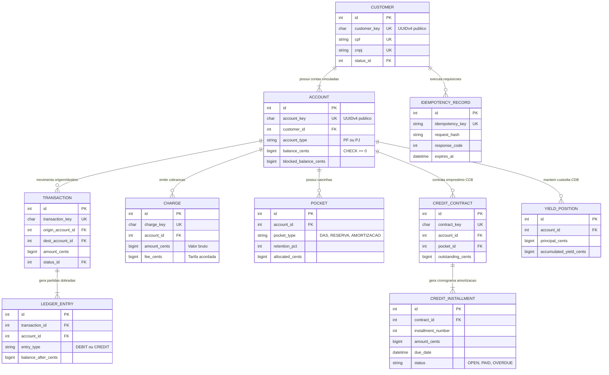
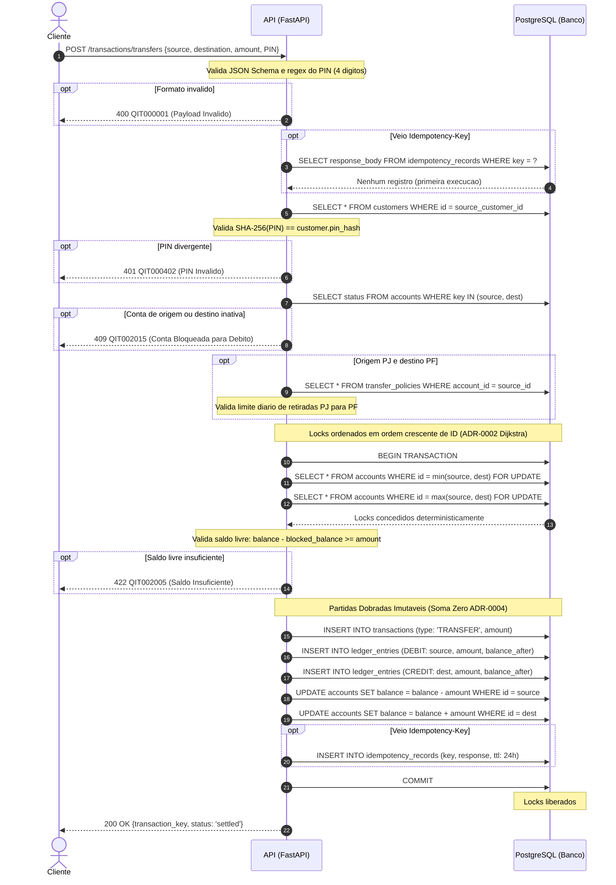
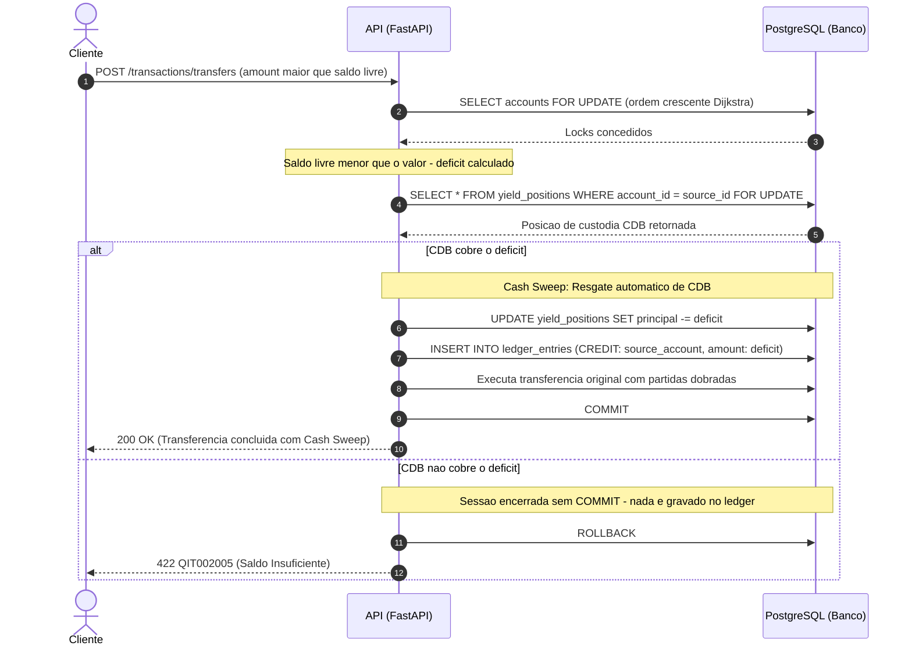
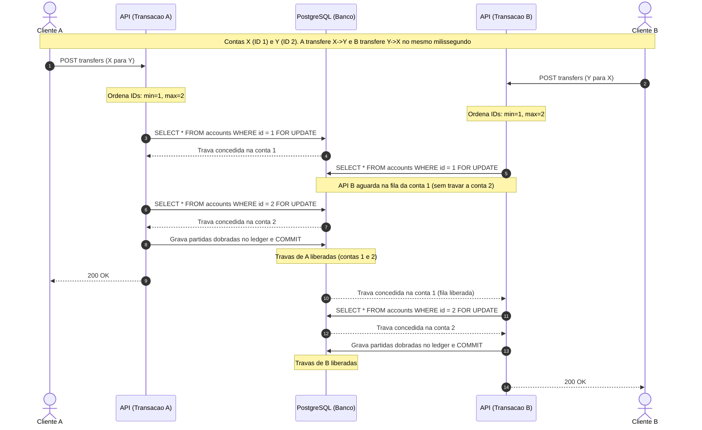
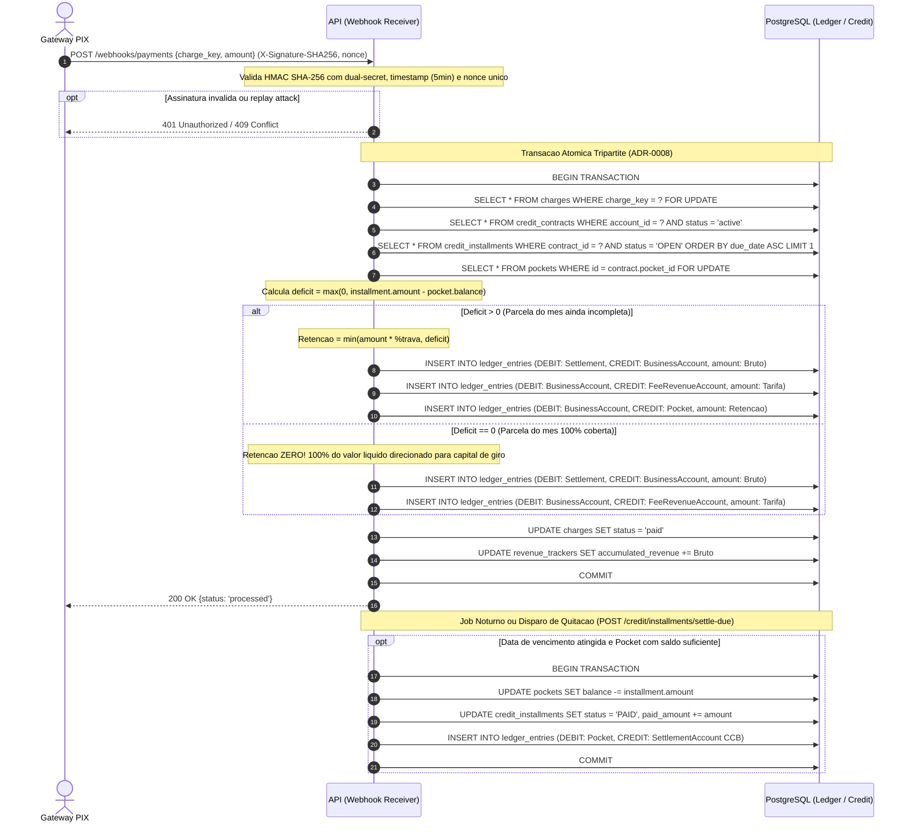

# RFC — CoreBank MEI: Banking-as-a-Service e Governança Patrimonial

| | |
|---|---|
| **Status** | **Concluído / Aprovado (v1.0)** |
| **Time** | João Pedro Calsavara · Bruno Cardoso Holanda · Marcel Rebecchi |
| **Data** | 12/10/2026 |
| **Versão** | 1.0 (Versão Final Consolidada) |

> [!NOTE]
> **Especificação Canônica Consolidada (v1.0)**:
> Esta RFC consolida a arquitetura completa do **CoreBank MEI**, integrando identidade e onboarding seguro, contas gêmeas vinculadas (PF e PJ), motor contábil imutável de partidas dobradas, cobrança comercial com tarifação atômica, tesouraria remunerada com envelopes financeiros (*Pockets*) e linhas de crédito CCB com trava inteligente de recebíveis.

---

## Contextualização

### Entendendo o problema

O Microempreendedor Individual (MEI) é juridicamente classificado como *Empresário Individual (natureza jurídica 213-5)*: perante o direito civil, a pessoa física (CPF) e a empresa (CNPJ) respondem com o mesmo patrimônio pessoal ilimitado. Todavia, sob as normas fiscais da Receita Federal (LC 123/2006) e regulatórias do Banco Central do Brasil, a movimentação da empresa deve ser mantida estritamente apartada da vida doméstica para apuração correta do faturamento bruto anual (teto de R$ 81.000,00) e distribuição isenta de lucros (`PROFIT_DISTRIBUTION`).

O sistema deve cadastrar o MEI e manter contas PF e PJ vinculadas, processar transferências atômicas e cobranças comerciais (PIX, boleto e cartão), garantir que o saldo corresponda a lançamentos contábeis de soma algébrica zero e impedir débitos duplicados por retentativas via `Idempotency-Key` (TTL 24h). Débitos exigem autorização criptográfica por **PIN Transacional de 4 dígitos** (SHA-256), segregado da senha de login. O sistema também gerencia subcontas virtuais (*Pockets*) para tributos (DAS-MEI) e reservas, remunera float ocioso em CDB 100% CDI sem risco de saldo negativo, e oferece Cédulas de Crédito Bancário (CCBs) com antecipação e **trava inteligente de recebíveis** limitada estritamente ao déficit da parcela vincenda, liberando 100% dos recebíveis subsequentes para o capital de giro.

Nesta versão não estão incluídos cartão físico, outras naturezas jurídicas (ME/EIRELI/LTDA) ou integração em tempo real com SPI/DICT; conectores externos operam em modo simulado.

### Explicando a solução de forma macro

A solução é uma API REST em Python/FastAPI com PostgreSQL, organizada nas camadas `resource` → `controller` → `repository` → `model`. O `Customer` é a identidade central, vinculada às contas gêmeas `PersonalAccount` (PF) e `BusinessAccount` (PJ). As movimentações utilizam livro-razão (*ledger*) imutável *append-only* de partidas dobradas, com valores monetários em `BIGINT` de centavos. Transferências concorrentes bloqueiam as contas em ordem determinística de IDs (hierarquia de Dijkstra), prevenindo deadlocks (`40P01`). Cobranças são liquidadas pelo valor bruto total com débito atômico da tarifa na mesma transação, e *Pockets* realizam retenções programadas para tributos e amortização de crédito com quitação automática.

- **Conta única com tags**: descartada pelo risco de misturar a movimentação PF/PJ e prejudicar o controle fiscal perante a Receita Federal. Ganharia apenas em simplicidade de banco de dados.
- **Net settlement**: descartado porque a tarifa seria descontada antes do crédito bruto, violando a Nota Fiscal (NFS-e) do MEI e falseando o teto anual do Simples Nacional de R$ 81.000,00. Ganharia em menos lançamentos.
- **FLOAT/DOUBLE**: descartado pelos erros de arredondamento acumulados em operações financeiras (IEEE 754). Ganharia apenas em prototipagem rápida.
- **Idempotência gravada na tabela de transação**: descartada porque impede o cache estruturado de respostas e o controle de requisições repetidas em falhas prévias. Ganharia em menor número de tabelas.

---

## Implementação

### Rotas Canônicas (Catálogo v1.0)

Todas as escritas críticas utilizam `Idempotency-Key` (ADR-0006). A mesma requisição retorna a resposta armazenada em cache; a mesma chave com payload divergente retorna `409 Conflict`.

| Método | Caminho | O que faz | Entrada | Saídas (status e quando) |
|---|---|---|---|---|
| `POST` | `/customers` | Cadastra o MEI e inicia KYC | CPF, CNPJ, e-mail, senha, PIN | 202 aceito; 400 payload inválido; 409 CPF/CNPJ/e-mail duplicado |
| `POST` | `/customers/{key}/kyc/analysis` | Avalia risco de compliance e certidões | score, flags, CNDs, CADSAN | 200 aprovado com cliente ativo; 422 irregularidade ou sanção |
| `POST` | `/customers/{key}/accounts` | Provisiona contas gêmeas PF e PJ vinculadas | customer_key | 201 criado; 409 cliente não ativo |
| `PUT` | `/accounts/{key}/status` | Ativa, bloqueia ou encerra conta (Res. 518) | status, motivo regulatório | 202 aceito; 409 saldo > 0 no encerramento voluntário |
| `PUT` | `/accounts/{key}/blocked-balance` | Aplica ou libera bloqueio cautelar MED | operação, valor, motivo | 200 saldo bloqueado/liberado |
| `POST` | `/transactions/transfers` | Realiza transferência atômica com Dijkstra | origem, destino, valor, PIN | 200 liquidada; 401 PIN inválido; 409 conta inativa; 422 saldo insuficiente |
| `POST` | `/transactions/cash-in` | Aporte com contrapartida contábil | conta, valor | 200 creditado com ledger |
| `GET` | `/accounts/{key}/statement` | Consulta extrato de partidas dobradas | account_key | 200 lista de lançamentos; 404 conta não encontrada |
| `POST` | `/accounts/{key}/charges` | Cria cobrança comercial (PIX, Boleto, Link) | valor, método, vencimento | 201 criada; 422 conta não é PJ |
| `POST` | `/webhooks/payments` | Liquidação externa com HMAC e Replay Protection | evento, charge_key, valor, assinatura | 200 liquidado pelo valor bruto com split de trava; 401 assinatura inválida; 409 replay attack |
| `POST` | `/accounts/{key}/pockets` | Cria caixinha/envelope financeiro | tipo (DAS/Reserva/Amortização) | 201 criado; 422 conta não é PJ |
| `POST` | `/governance/transfer-policies` | Define limites de retirada PJ → PF | limite diário, aprovação | 201 configurado; 422 violação de política |
| `POST` | `/credit/contracts` | Contrata CCB com Tabela Price | valor, prazo, juros, %trava | 201 desembolsado na PJ e pocket criado |
| `POST` | `/credit/installments/settle-due` | Quita parcelas vencidas via pocket | target_date | 200 parcelas quitadas como PAID |
| `POST` | `/credit/anticipations` | Antecipa recebíveis comerciais | cobranças elegíveis, taxa | 201 creditado líquido; 422 cobrança inelegível |
| `POST` | `/treasury/accrue-yield` | Apura rendimento diário CDB 100% CDI | taxa CDI diária | 200 rendimento líquido creditado |

---

### Banco de Dados (Diagrama de Entidade-Relacionamento)



---

### Fluxos de Execução (Diagramas de Sequência)

#### Fluxo 1: Transferência – Caminho Feliz

O fluxo representa a validação de formato e PIN, a verificação de idempotência, o bloqueio ordenado de Dijkstra, a validação de saldo livre e a gravação atômica dos lançamentos contábeis em partidas dobradas.



---

#### Fluxo 2: Transferência – Saldo Insuficiente e Resgate Automático de CDB (Cash Sweep)

Quando o saldo disponível não cobre o valor solicitado, o motor financeiro verifica a posição de tesouraria do cliente. Se o saldo de CDB cobrir o déficit, executa o resgate automático (*Cash Sweep*); caso contrário, a transação é abortada sem escritas no ledger contábil.



---

#### Fluxo 3: Transferências Concorrentes – Prevenção Matemática de Deadlock

Em transferências simultâneas cruzadas entre as mesmas contas (X transfere para Y e Y transfere para X no mesmo milissegundo), os IDs internos são ordenados antes da aquisição dos bloqueios. Ambas as transações disputam a mesma ordem global, eliminando esperas circulares e o erro PostgreSQL `40P01`.



---

#### Fluxo 4: Liquidação com Trava Inteligente CCB e Quitação de Parcela

Demonstra a liquidação de vendas comerciais via webhook PIX. A trava inteligente calcula o déficit da próxima parcela em aberto e limita a retenção estritamente ao necessário. Quando a parcela já está provisionada no `AmortizationPocket`, a retenção é zero, preservando o capital de giro operacional do MEI.



---

## Principal Desafio

- **Qual é:** Garantir atomicidade contábil e imunidade a deadlocks em operações financeiras concorrentes de alta frequência, mantendo a liquidação de cobranças com tarifação atômica e a amortização contínua de CCBs através de uma trava de recebíveis inteligente que preserve o capital de giro do MEI.
- **Por que é difícil:** Se cada transação bloquear as contas na ordem arbitrária recebida no payload, transferências simultâneas em sentidos opostos (A→B e B→A) geram contenção circular imediata e erro PostgreSQL `40P01`. Em paralelo, gateways tradicionais deduzem tarifas antes do crédito, destruindo o espelhamento do faturamento bruto exigido pela Receita Federal na Nota Fiscal (NFS-e). Por fim, travas de crédito cegas retêm percentuais fixos de todas as vendas, drenando a liquidez operacional do empreendedor mesmo após a parcela do mês já ter sido provisionada.
- **Como o desenho resolve:**
  1. **Hierarquia de Dijkstra**: Antes de qualquer `SELECT FOR UPDATE`, os IDs internos das contas são deterministicamente ordenados em ordem crescente:
  ```python
  first_id, second_id = sorted([src_account.id, dst_account.id])
  ```
  Assim, todas as transações adquirem bloqueios na mesma ordem global no PostgreSQL, tornando a espera circular impossível.
  2. **Tarifação Atômica no Ledger**: A liquidação credita a venda pelo valor bruto e debita a tarifa na mesma transação atômica, preservando a auditoria fiscal de faturamento (teto de R$ 81.000,00) e a receita da instituição.
  3. **Teto Inteligente de Trava de Recebíveis**: A retenção é calculada dinamicamente a cada venda como:
  ```python
  deficit = max(0, next_installment.amount - pocket.current_balance)
  retained = min(int(sale_amount * (contract.retention_pct / 100)), deficit)
  ```
  No instante em que a caixinha atinge o valor exato da parcela vincenda, a retenção é automaticamente zerada (`retained = 0`), liberando 100% dos recebimentos subsequentes para o giro livre do negócio.
